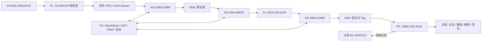

# EYEPQC：基于 ML-KEM 与 AES-GCM 的单向 JPEG 视频保护系统

**技术报告稿 | 更新：2026-10-11**
本文按当前仓库记录和可追溯测试证据整理。赛事协办方[赛程页](https://www.gowinsemi.com.cn/university/match2026)与[高校通知](https://wdz.qust.edu.cn/info/1055/1203.htm)列出作品提交截止时间为 2026-11-04 18:00；队伍报名/资格状态、AMD 具体赛道细则和报告/视频模板仍待核对。本文是技术报告草稿，不代表组委会格式的最终定稿。系统有历史和最新候选的实板证据，但 G0 SD 启动、G7 receiver-exit 恢复和生产安全尚未通过。

电脑端最新完整回归为 19/19，M04/M05 使用原生 XSim；结果标记 `board_accessed=false`，详见[回归报告](software_regression_20261011.md)。历史候选 `candidate006d` 的 camera-reset 与 routing-stall 各 20/20 通过；`candidate012` 的 receiver-exit 批次在 13/20 后失败，同构建普通 CDC 重连基线认证 141 帧、1,130 包、47.672 fps。后续 `candidate014` 增加同 HELLO 缓存 ACK 重放、有界主机重试及半帧保护，ARM 构建、197 项哈希预检、G6 离线测试 25/25、runner 测试 9/9、M04/M05 补测及 20 轮软件 Mock 通过，但 `board_validated=false`，没有任何该候选实板通过轮次。普通重连和软件 Mock 不能替代故障恢复门禁。独立 KX41 候选已完成 software、hardware、timeout fallback 三窗口各 60/60 KAT；该独立工程不代表正式视频构建集成。M02 的用户确认整板断电/上电后 JTAG 配置 20/20 及无摄像头 fail-closed 已通过，但不代表 SD 独立启动或 DVP/JPEG 实拍。以上证据均不构成整机、G0/G7 或生产安全验收。

## 摘要

EYEPQC 是面向正点原子领航者 Zynq-7020 与 OV5640 JPEG 摄像头的单向视频保护原型。摄像头输出 JPEG 后，PL 侧执行采集、异步跨时钟域、DMA 数据搬运和 AES-128-GCM 加密；PS 侧负责 ML-KEM-512 握手、会话状态、DMA 调度和 USB CDC 通信。主机先验证每个视频分片的 GCM 标签，再重组并解码 JPEG。视频只从板卡发送到主机，握手和控制消息使用同一双向 CDC 字节流。

项目已有固定 DDR 数据 AES-GCM、摄像头 JPEG 加密、USB 视频传输、标签篡改拒绝和开发态 ML-KEM 动态会话的历史板测证据。历史 G4 明文视频约 47.258 fps、G5 AES-GCM 视频约 47.270 fps，来自 2026-09-29 的 CF7020B 实测；它们不是当前候选的持续性能结果。`candidate006d` 的单次短时认证视频为 471 帧、47.3579 fps，受控 camera-reset 与 routing-stall 各 20/20 恢复通过。`candidate012` 的普通无 JTAG CDC 重连基线为 141 帧、1,130 包、47.672 fps；其 receiver-exit 单轮仍失败，G7 未通过。详细身份和证据边界见[candidate012 报告](g7_candidate012_tx_ownership_board_20261011.md)、[006d 验收报告](g7_candidate006d_acceptance_20261010.md)及[验收矩阵](acceptance_matrix_20261009.md)。

较早的 Keccak 身份核验优化版只覆盖 tcId 76 三次启动，HW 慢约 8.41%；更新的独立 KX41 候选现已覆盖 60 个唯一向量的 software/hardware/timeout fallback 三个窗口，硬件窗口计时为软件的 88.6%。该结果仍限于独立候选，并未集成正式视频工程，也未读回 Keccak 内部 STATE/OUTPUT；见[KX41 板测报告](keccak_sponge_x4_capture_fix_20261011.md)。CPU 本地协议缓冲清理和 candidate007 的历史双会话功能回归不证明全域清零，见[清理实施记录](security_cleanup_20261010.md)。

## 1. 目标与边界

系统目标是在传输链路上保护 JPEG 视频的机密性和完整性，并在主机端仅于认证成功后输出明文图像。威胁边界、第一版功能需求和未解决安全事项见[项目目标](../doc/goals.md)与[协议](../doc/protocol.md)。

第一版使用 AES-128-GCM 为视频分片提供加密与认证；ML-KEM-512 用于派生会话密钥。当前实现属于功能原型：静态板端私钥/种子由 JTAG 注入，缺少生产级可信熵源、密钥存储、侧信道和故障防护；v1 也不提供主机身份认证。不得据此宣称量产安全或抵抗主动中间人攻击。

## 2. 硬件与系统架构

本次用户提供的照片显示 ATK-DIY7010/7020P 底板、CF7010B/7020B 核心板标签 `ZYNQ 7020`、两颗海力士 DDR，以及 ATK-MC5640 V1.2 摄像头。当前 Vivado XSA 的器件为 `xc7z020clg400-2`；首次下载仍应经 JTAG 确认目标 IDCODE。

系统按阶段拆分，避免把单模块证据扩大解释为整机验收：M02 配置 OV5640；M03/M04 完成 DVP 帧检查和整帧提交；M05 管理 DMA/DDR；M08 执行 PL AES-GCM；M09/M10 实现 ML-KEM 与会话控制；M11/M12 负责 USB 记录、认证回放和主机解码。模块判据与复现步骤见[实施步骤](../doc/steps.md)。

## 3. 协议与密码处理

USB CDC 使用 `channel:u8 || record_length:u16_be || record` 外层记录，将控制通道和视频通道分帧。加密视频分片由 40 字节头、至多 1400 字节密文载荷和 16 字节 GCM Tag 组成；完整头作为 AAD。Nonce 为 32 位会话 epoch 与 64 位包序号的连接，包序号在会话内严格递增。主机先做结构长度检查，再验证 GCM Tag；认证失败不返回明文，也不推进重放窗口或帧状态。

握手顺序为 HELLO、HELLO_ACK、ML-KEM 密文、板端 Finished、主机 Finished、认证 START。M10 从共享秘密和完整握手 transcript 经 HKDF-SHA256 派生视频密钥、控制密钥、Nonce 前缀和会话标识；控制命令由 HMAC-SHA256 认证并带有单调序号。具体线格式、长度限制、错误处理与已知边界见[协议定义](../doc/protocol.md)。

板端 ML-KEM 采用固定版本的 PQCA `mlkem-native` v1.3.0。PC/PS 共享同一 C 实现；开发态测试私钥与主机生成的 seed 通过 JTAG 装载。当前板端 `board_random()` 以注入 seed 和 host_random/counter 计算 HMAC 输出；这不证明存在可信板端熵源，也不等于安全密钥注入或断电持久化。生产密钥、熵源与清零缺口及验收路线见[生产安全计划](production_security_plan_20261010.md)。

## 4. 实验结果

下表汇总可追溯结果。历史行与当前候选行分别标注构建/日期；单模块、隔离工程和短窗口数据不外推为整机连续性能。

| 测试 | 结果 | 证据范围 |
|---|---:|---|
| AES 核 M06 | 13 组 NIST/随机块结果通过；53 个 100 MHz 周期/块；2600 LUT、2566 FF、0 BRAM、0 DSP | AES 单块核与 AXI 包装；不含 DMA/GHASH，见 [M06](../doc/m06.md) |
| ML-KEM M09 | ACVP 25 KeyGen、25 Encaps、10 Decaps 组一致；1000 次重复；A9 平均约 11.929 ms/次，栈水位约 12,860 B、堆 0 | PS 软件基线，见 [M09](../doc/m09.md) |
| M08 AXI-GCM | 102 组端到端向量及随机背压/异常/零化仿真通过；6370 LUT、5679 FF、0 BRAM、0 DSP | 独立 PL IP；OOC 资源，见 [M08](../doc/m08.md) |
| G2 固定 DDR 加密 | 21 组不同长度数据通过主机逐字节比较和认证解密 | 实板 DDR→DMA→M08→DMA→DDR，见 [G2](../doc/g2.md) |
| G3 摄像头加密 | 320×240 连续 1000 帧约 47.172 fps；640×480 连续 1000 帧约 47.168 fps；报告为零丢帧/溢出 | 历史 CF7020B 实板记录；末帧逐包认证解密，非本轮新 ELF 实测，见 [G3](../doc/g3.md) |
| G4 USB 明文 | 1799.953 秒、85,064 帧、47.258 fps | 历史 USB 实拍长测，逐帧解码，见 [G4/G5](../doc/g4_g5.md) |
| G5 USB 加密 | 59.953 秒、2835 帧、47.270 fps；真实包 Tag 篡改被拒绝 | 历史 CF7020B 实板测试，见 [G4/G5](../doc/g4_g5.md) |
| G6 动态会话 | 双会话换钥、坏 Finished 拒绝和 DTR 逻辑重连通过，吞吐约 47 fps | 开发态测试密钥/JTAG 注入，不是生产安全验收，见 [G6](../doc/g6.md) |
| G7 `candidate006d` 短测与受控恢复 | 短时认证视频 471 帧、47.3579 fps；camera-reset 20/20、routing-stall 20/20 | 同一候选构建的限定证据；PC退出/DTR 20 次和物理USB拔插20次待测，不能据此判定 G7 整体通过，见 [006d 报告](g7_candidate006d_acceptance_20261010.md) |
| G7 `candidate012` USB 基线/故障恢复 | 普通 CDC 重连认证 141 帧、1,130 包、47.672 fps；receiver-exit 单轮在 HELLO_ACK 等待处失败，主机 39 次读取为 0 字节 | 同一构建、无 JTAG 重载的普通重连与故障恢复分开计；dTD completion 不能证明 CDC 用户态收到 ACK，G7 未通过，见 [candidate012 报告](g7_candidate012_tx_ownership_board_20261011.md) |
| G7 `candidate014` 软件候选 | ARM 构建、197 项哈希预检、G6 离线 25/25、runner 9/9、项目补测和软件 Mock 20/20 通过 | 仅离线候选；`board_validated=false`、实板 0 轮。缓存 ACK/有界重试方案仍需先做同构建基线、ETW/AP0 单轮和 receiver-exit 20/20，见 [candidate014 报告](g7_candidate014_safe_hello_ack_retry_offline_20261011.md) |
| 电脑端完整回归 | 19/19 门禁通过，含 M04/M05 原生 XSim | `run_demo.ps1 -Mode Check` 本次结果标记 `board_accessed=false`；不覆盖实板验收，见[回归报告](software_regression_20261011.md) |
| M02 冷启动及模组缺席 | 用户确认 20 次整板断电/上电后的 JTAG 配置 20/20；全断电拔除摄像头后 fail-closed 通过 | 限 JTAG 配置与 fail-closed；SD/Flash 独立启动和 DVP/JPEG 实拍未测，见 [M02 报告](m02_sensor_reset_board_20261011.md) |
| 旧 Keccak 隔离工程 | tcId 76 ML-KEM-512 解封装路径 3 轮功能通过；HW 相对同启动 SW 平均慢 8.62% | 独立 PS+PL/XSA，不是正式视频工程；故障回退和 STATUS 读回通过，不证明全域清零；见 [Keccak 实板基准](keccak_board_benchmark_20261010.md) |
| KX41 独立固件 | software、hardware、timeout fallback 三窗口各 60/60 个 ML-KEM-512 KAT；硬件窗口 ticks 为软件的 88.6% | 仅限独立候选和所测 60 个唯一向量，不外推到正式视频构建、内部状态清零或完整产品性能，见 [KX41 实板报告](keccak_sponge_x4_capture_fix_20261011.md) |

G3 implementation report 中 Vivado 2026.1 设计 WNS 为 +0.013 ns、WHS 为 +0.018 ns。DRC 有 warning/advisory，其中 OV5640 PCLK 的 `PLCK-12` 非专用时钟路由警告通过 `CLOCK_DEDICATED_ROUTE FALSE` 放行；必须保留该风险，不能写成“零告警”或“无时序风险”。KX41 的 WNS/WHS 属于不同的独立 XSA，不能替代该 G3 报告。

## 5. 复现与交付

工具根目录由 `EYEPQC_TOOL_ROOT` 指定，相关本机记录使用 `E:/fpg/2026.1`。源码、仿真、构建与板测入口见 [README](../README.md)、[G3 操作说明](../doc/g3.md)、[M15 交付要求](../doc/steps.md#19-m15调试观测与交付材料) 和[电脑端构建记录](pc_build.md)。电脑端回归、哈希预检和时序报告都不等同于实板验收。`candidate012`、`candidate006d` 和 KX41 的构建 manifest 与板测结果分别见[对应报告](g7_candidate012_tx_ownership_board_20261011.md)、[006d 报告](g7_candidate006d_acceptance_20261010.md)、[KX41 报告](keccak_sponge_x4_capture_fix_20261011.md)；软件检查、构建身份与板测范围须分别引用各自证据，不跨候选借用。

## 6. 尚待完成的竞赛验收

1. G0 的 JTAG 临时启动/局部 DDR/timer/LED 有限定证据；SD 独立启动、物理复位与 30 分钟断电冷启动仍未验收。用户目前没有读卡器，板上 SD 保持原样；需要专用介质及现场步骤才能补测。不能将 JTAG 结果写成 SD 或全 DDR 验收。
2. G7 的 camera-reset/routing-stall 20/20 是历史 `candidate006d` 的受控场景结果。`candidate012` receiver-exit 批次在 13/20 后失败；`candidate014` 的缓存 ACK 重放/有界重试仅通过离线验证，仍需新候选同构建短基线、ETW/AP0 单轮、receiver-exit 20/20，再完成 USB 物理拔插 20/20。旧候选轮次不折算，根因仍未确认。约 50 分钟运行属于时长例外，未实测满两小时。
3. 较早的 Keccak 路径 tcId 76 三轮通过但硬件慢约 8.62%；KX41 更新候选现有 60/60 三窗口 KAT，硬件窗口 ticks 为软件的 88.6%。二者均为独立工程，KX41 未集成正式视频，且内部 STATE/OUTPUT 清零未读回；不得把单候选 KAT 窗口称作系统级 ML-KEM 加速。
4. 生产安全未通过：可信板端熵源、生产私钥存储/注入、全域清零读回及侧信道/故障防护均未完成；目前证据不能形成熵源、生产安全或全清零主张。
5. 赛事协办方赛程页列出 2026-11-04 18:00 截止，但需从官网/报名后台复核是否更新并确认队伍资格。AMD FPGA 赛道报告、视频及代码附件细则尚待官方文件；已检索到的芯片应用赛道上传格式不移用至本赛道。本文暂按技术证据编写，不臆造模板或验收标准，见[官方规则核验记录](contest_rules_review_20261011.md)。
