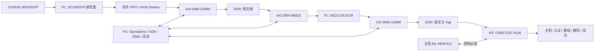

# EYEPQC：基于 ML-KEM 与 AES-GCM 的单向 JPEG 视频保护系统

**技术报告稿 | 更新：2026-10-06**
本文按当前仓库与已有测试记录撰写。比赛名称、评分细则、排版模板尚未提供；当前工作副本的最终实板复验也未完成，因此本文不等同于组委会格式的最终定稿。

同日软件阶段更新：当前 `software_ready` 已生成四套固件、匹配 FSBL/`BOOT.BIN`；
M04/M05 原生 XSim 与 G6 内存 USB 集成检查通过，见[软件交付记录](software_ready.md)。
正文保留早期构建范围，当前电脑端验收以该记录为准；新产物仍未上板。

## 摘要

EYEPQC 是面向正点原子领航者 Zynq-7020 与 OV5640 JPEG 摄像头的单向视频保护原型。摄像头输出 JPEG 后，PL 侧执行采集、异步跨时钟域、DMA 数据搬运和 AES-128-GCM 加密；PS 侧负责 ML-KEM-512 握手、会话状态、DMA 调度和 USB CDC 通信。主机先验证每个视频分片的 GCM 标签，再重组并解码 JPEG。视频只从板卡发送到主机，握手和控制消息使用同一双向 CDC 字节流。

项目已有固定 DDR 数据的 AES-GCM 板测、摄像头 JPEG 加密、USB 视频传输、标签篡改拒绝和 ML-KEM 动态会话板测证据。历史 G4 明文视频约 47.258 fps，G5 AES-GCM 视频约 47.270 fps；这些结果来自 2026-09-29 的 CF7020B 实测。当前 2026-10-06 工作副本另生成了带哈希清单的 G3 ELF/bitstream/XSA 组合，但清单 `board_validated` 为 `false`，不可把历史实测直接当作当前构建的上板验收。

## 1. 目标与边界

系统目标是在传输链路上保护 JPEG 视频的机密性和完整性，并在主机端仅于认证成功后输出明文图像。威胁边界、第一版功能需求和未解决安全事项见[项目目标](../doc/goals.md)与[协议](../doc/protocol.md)。

第一版使用 AES-128-GCM 为视频分片提供加密与认证；ML-KEM-512 用于派生会话密钥。当前实现属于功能原型：静态板端私钥/种子由 JTAG 注入，缺少生产级可信熵源、密钥存储、侧信道和故障防护；v1 也不提供主机身份认证。不得据此宣称量产安全或抵抗主动中间人攻击。

## 2. 硬件与系统架构

本次用户提供的照片显示 ATK-DIY7010/7020P 底板、CF7010B/7020B 核心板标签 `ZYNQ 7020`、两颗海力士 DDR，以及 ATK-MC5640 V1.2 摄像头。当前 Vivado XSA 的器件为 `xc7z020clg400-2`；首次下载仍应经 JTAG 确认目标 IDCODE。

系统按阶段拆分，避免把单模块证据扩大解释为整机验收：M02 配置 OV5640；M03/M04 完成 DVP 帧检查和整帧提交；M05 管理 DMA/DDR；M08 执行 PL AES-GCM；M09/M10 实现 ML-KEM 与会话控制；M11/M12 负责 USB 记录、认证回放和主机解码。模块判据与复现步骤见[实施步骤](../doc/steps.md)。

## 3. 协议与密码处理

USB CDC 使用 `channel:u8 || record_length:u16_be || record` 外层记录，将控制通道和视频通道分帧。加密视频分片由 40 字节头、至多 1400 字节密文载荷和 16 字节 GCM Tag 组成；完整头作为 AAD。Nonce 为 32 位会话 epoch 与 64 位包序号的连接，包序号在会话内严格递增。主机先做结构长度检查，再验证 GCM Tag；认证失败不返回明文，也不推进重放窗口或帧状态。

握手顺序为 HELLO、HELLO_ACK、ML-KEM 密文、板端 Finished、主机 Finished、认证 START。M10 从共享秘密和完整握手 transcript 经 HKDF-SHA256 派生视频密钥、控制密钥、Nonce 前缀和会话标识；控制命令由 HMAC-SHA256 认证并带有单调序号。具体线格式、长度限制、错误处理与已知边界见[协议定义](../doc/protocol.md)。

板端 ML-KEM 采用固定版本的 PQCA `mlkem-native` v1.3.0。PC/PS 共享同一 C 实现；开发态测试密钥与种子保存在 Git 忽略目录，并可由 JTAG 装载。此流程便于复现实验，但不等于安全密钥注入或断电持久化。

## 4. 实验结果

下表汇总报告中可追溯的结果。板测数值标注了历史日期；2026-10-06 的新 G3 ELF 尚未进行板端复验。

| 测试 | 结果 | 证据范围 |
|---|---:|---|
| AES 核 M06 | 13 组 NIST/随机块结果通过；53 个 100 MHz 周期/块；2600 LUT、2566 FF、0 BRAM、0 DSP | AES 单块核与 AXI 包装；不含 DMA/GHASH，见 [M06](m06.md) |
| ML-KEM M09 | ACVP 25 KeyGen、25 Encaps、10 Decaps 组一致；1000 次重复；A9 平均约 11.929 ms/次，栈水位约 12,860 B、堆 0 | PS 软件基线，见 [M09](m09.md) |
| M08 AXI-GCM | 102 组端到端向量及随机背压/异常/零化仿真通过；6370 LUT、5679 FF、0 BRAM、0 DSP | 独立 PL IP；OOC 资源，见 [M08](m08.md) |
| G2 固定 DDR 加密 | 21 组不同长度数据通过主机逐字节比较和认证解密 | 实板 DDR→DMA→M08→DMA→DDR，见 [G2](g2.md) |
| G3 摄像头加密 | 320×240 连续 1000 帧约 47.172 fps；640×480 连续 1000 帧约 47.168 fps；报告为零丢帧/溢出 | 历史 CF7020B 实板记录；末帧逐包认证解密，非本轮新 ELF 实测，见 [G3](g3.md) |
| G4 USB 明文 | 1799.953 秒、85,064 帧、47.258 fps | 历史 USB 实拍长测，逐帧解码，见 [G4/G5](g4_g5.md) |
| G5 USB 加密 | 59.953 秒、2835 帧、47.270 fps；真实包 Tag 篡改被拒绝 | 历史 CF7020B 实板测试，见 [G4/G5](g4_g5.md) |
| G6 动态会话 | 双会话换钥、坏 Finished 拒绝和 DTR 逻辑重连通过，吞吐约 47 fps | 开发态测试密钥/JTAG 注入，不是生产安全验收，见 [G6](g6.md) |

实现报告中 Vivado 2026.1 当前 G3 设计 WNS 为 +0.013 ns、WHS 为 +0.018 ns。DRC 有 warning/advisory，其中 OV5640 PCLK 的 `PLCK-12` 非专用时钟路由警告通过 `CLOCK_DEDICATED_ROUTE FALSE` 放行；必须保留该风险，不能写成“零告警”或“无时序风险”。

## 5. 复现与交付

工具根目录由 `EYEPQC_TOOL_ROOT` 指定，本机为 `E:/fpg/2026.1`。源码、仿真、构建与板测入口见 [README](../README.md)、[G3 操作说明](g3.md)、[M15 交付要求](../doc/steps.md#19-m15调试观测与交付材料) 和[电脑端构建记录](pc_build.md)。当前 G3 电脑端目录在 Git 忽略的 `build/vitis/g3_delivery`，包含清单、ELF、bitstream 和 `ps7_init.tcl`；XSA/源码/产物哈希已核对。

本轮 Windows 检查中 M00、M08、M09、M10、M12、G3 主机、G5 和 M01/M02/M03/M07 离线测试通过；M04/M05 的原生 XSim 因本机 Vivado 附带 GCC 6.2 编译问题未通过本轮复验。M05 帧所有权、AXIS 路由 4 模式/4000 组随机验证和 DMA 缓冲区 10000 轮检查通过。Icarus 13 编译进程偶发退出异常时，共享兜底只在返回特定访问冲突码且已有非空产物时继续，仍必须由 `vvp` 完成仿真并匹配功能标记。当前无 JTAG 下载器枚举，也没有运行 `hw_server`，所以当前 G3 清单保持 `board_validated=false`。这些限制与历史板测证据分开记录于[提交检查表](competition_submission.md)。

## 6. 尚待完成的竞赛验收

1. 重新建立可运行的 Windows XSim/Icarus 仿真环境并复跑 M04/M05 等相关门禁。
2. 当前构建接入真实 JTAG、摄像头并执行 G3 实板验收，保存结果 JSON、日志和图像证据。
3. 如赛制要求 SD 冷启动，先修复 Vitis Processor List/Lopper 平台生成，再基于当前 XSA 生成匹配 FSBL/`BOOT.BIN` 并实测；当前产物未生成。
4. 补齐 G0、M13 与 G7 故障注入/恢复项；G7 两小时长测虽获时长豁免，但故障项未完成。
5. 明确生产级密钥/熵源、安全边界与 USB VID/PID 方案。
6. 按组委会模板调整篇幅、图表、声明和附件。当前尚未拿到比赛评分细则或提交模板。
